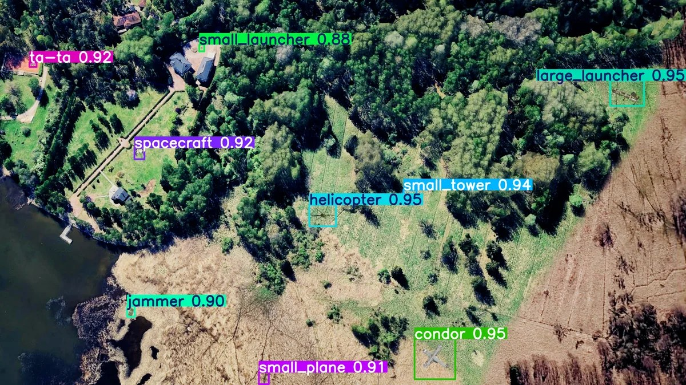
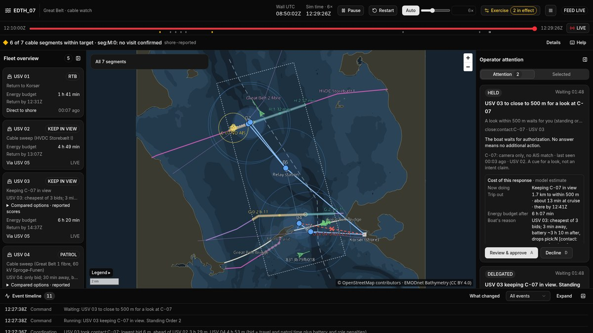
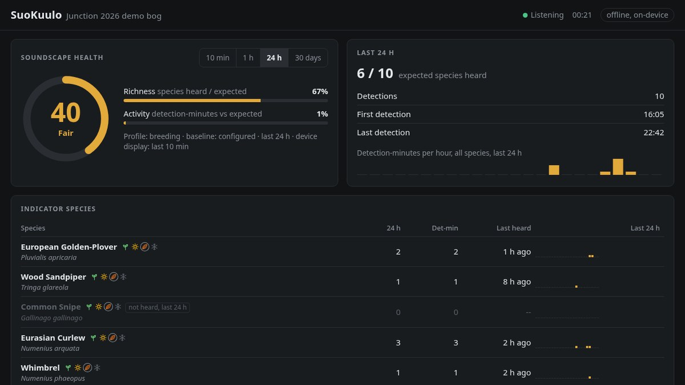
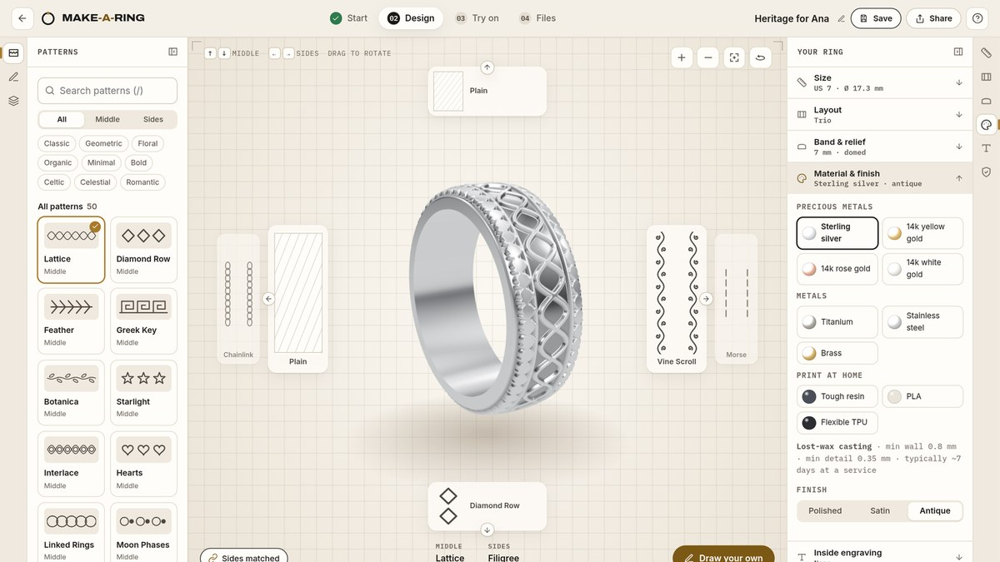

# Franciszek Kossut

B.Sc. student in Artificial Intelligence at the University of Southern Denmark, Vejle.

I build machine learning pipelines in Python, from computer vision to speech and language models, and I run the Linux servers they live on.

Founder of [Elysa's Secret](https://elysasecret.com), a hackathon team of four first-year students from SDU.

**Hackathon results:**

- **Junction 2026 (Espoo, Finland), Europe's biggest hackathon:** two podiums with Elysa's Secret.
  - **2nd place 🥈, AfterQuery "Break the Agent":** [OnCall](https://github.com/imbreaszaboccs-star/Break_an_AGent), an RL environment where frontier AI agents play the on-call engineer for a platform that is already failing.
  - **3rd place 🥉, Arduino "Green European Renaissance":** [SuoKuulo](https://github.com/emermelada/suokuulo), an offline bird-biodiversity monitor for restored peatlands, running on the Arduino UNO Q.
- **1st place 🥇, Nordic AI Cup 2026, Danish national championship:** national winner with Elysa's Secret, 1st of 82 teams.
- **1st place 🥇, Hyperbloom October, UI/UX and Web Design:** [Make-a-Ring](https://devpost.com/software/1483153), built with Javier Arévalo. 1st of 738 participants.

## Projects

| [Nordic AI Cup: drone flyby detection](https://github.com/emermelada/nordic-ai-cup) | [PHAROS](https://github.com/elysassecret/EDTH_07) |
| :---: | :---: |
|  |  |
| **[SuoKuulo](https://github.com/emermelada/suokuulo)** | **[Make-a-Ring](https://github.com/FearedLynx/make-a-ring)** |
|  |  |

| Project | What it is | Stack |
| --- | --- | --- |
| [OnCall](https://github.com/imbreaszaboccs-star/Break_an_AGent) | Incident-response RL environment with 20 MCP tools. Frontier models scored below our reference run in every test. Junction 2026, AfterQuery 2nd place | Python, MCP, Docker, pytest |
| [SuoKuulo](https://github.com/emermelada/suokuulo) | BirdNET on the Arduino UNO Q turns bog birdsong into a 0-100 health score, sent over LoRa. No cloud, no audio stored. Junction 2026, Arduino 3rd place | Python, TFLite, Arduino, LoRa |
| [PHAROS](https://github.com/elysassecret/EDTH_07) | Leaderless swarm of five uncrewed boats guarding undersea cables: peer-to-peer task auctions, self-repair when a boat fails, one operator approves anything beyond watching. Pitched at EDTH Copenhagen 2026 (European Defence Tech Hackathon). [Write-up](https://elysasecret.com/edth) | Python, TypeScript, React |
| [Nordic AI Cup 2026](https://github.com/emermelada/nordic-ai-cup) | Three ML tasks with team Elysa's Secret: medical audio, drone object detection, a survival simulator. National winner, Denmark | Python, YOLO11, faster-whisper, CMA-ES |
| [Make-a-Ring](https://github.com/FearedLynx/make-a-ring) | Ring design studio in the browser, with print-ready STL and OBJ export. Hyperbloom October winner. [Try it live](https://kossut.dev/make-a-ring/app/) · [Video](https://www.youtube.com/watch?v=vbq_CKkNmOE) | JavaScript, Preact, three.js |
| [Product listing agent](https://github.com/FearedLynx/product-listing-agent-mcp) | MCP server that lets Claude write and check product listings against 12 brand rules | Python, MCP, pytest, GitHub Actions |
| [MealPlanner](https://github.com/FearedLynx/MyFridgeApp) | Android app for meal planning, calorie tracking and shopping lists | TypeScript, React Native, Expo, SQLite |

## Find me on

[Website](https://kossut.dev) · [LinkedIn](https://www.linkedin.com/in/franciszek-kossut-1967633a8/) · [LeetCode](https://leetcode.com/u/FearedLynx_/) · fkossut.inter@gmail.com

<picture>
  <source media="(prefers-color-scheme: dark)" srcset="https://raw.githubusercontent.com/FearedLynx/FearedLynx/output/github-snake-dark.svg" />
  
</picture>

